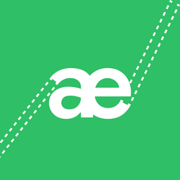

<div align="center">



# AEmulator Green

**Klasik Android yazılımları — HTC Sense, TouchWiz, MIUI, AOSP — modern bir telefonda. Root ve PC gerekmez.**

[🇬🇧 English](../../README.md) · [🇷🇺 Русский](README.ru.md) · [🇺🇦 Українська](README.uk.md) · [🇩🇪 Deutsch](README.de.md) · [🇫🇷 Français](README.fr.md) · [🇪🇸 Español](README.es.md) · [🇧🇷 Português](README.pt-BR.md) · [🇮🇹 Italiano](README.it.md) · [🇵🇱 Polski](README.pl.md) · **🇹🇷 Türkçe** · [🇸🇦 العربية](README.ar.md) · [🇮🇷 فارسی](README.fa.md) · [🇮🇳 हिन्दी](README.hi.md) · [🇮🇩 Indonesia](README.id.md) · [🇻🇳 Tiếng Việt](README.vi.md) · [🇨🇳 简体中文](README.zh-CN.md) · [🇯🇵 日本語](README.ja.md) · [🇰🇷 한국어](README.ko.md)

</div>

---

AEmulator Green gerçek bir Android 2.3–7.x sistemini doğrudan yazılım dosyasından başlatır: recovery ZIP, Odin arşivi veya Google fabrika imajı. Eski ARM kodu değiştirilmiş QEMU ile çevrilir, çekirdeğin binder’ı taklit edilir, grafikler telefonun GPU’sunu, ses Android’in ses altyapısını kullanır — hepsi sıradan bir uygulamanın içinde.

## ✨ Özellikler

- Neredeyse her biçimi içe aktarma: CWM/TWRP ZIP, Samsung Odin `.tar.md5`, Google fabrika `.tgz`, `system.img`, OTA `system.new.dat.br`
- Üretici arayüzleri olduğu gibi çalışır: HTC Sense, Samsung TouchWiz, MIUI, AOSP
- GL köprüsüyle donanım grafikleri, ses, dokunma ve çoklu dokunma, modern TLS vekilli ağ
- APK, müzik ve fotoğraflar için ortak hafıza kartı klasörü
- 18 dilde Material 3 Expressive arayüz
- Ücretsiz ve açık kaynak (GPL-3.0)

## 🚀 Hızlı başlangıç

1. APK’yı [Releases](https://github.com/djibril33445/AEmulator-Green/releases) sayfasından indirip kurun.
2. AEmulator Green’ı açın → **Yazılım ekle** ve dosyayı seçin. İçe aktarma birkaç dakika sürer.
3. **Başlat**’a basın. İlk açılış daha uzundur: sistem uygulamaları optimize eder.
4. ⋮ menüsü: ses, güç düğmesi ve günlük; ⚙️ ayarları ve dili açar.

## 📋 Gereksinimler

- 64 bit ARM telefonda Android 8.0+ (arm64-v8a)
- Yazılım başına yaklaşık 1–3 GB boş alan
- Önerilen: yeni bir Snapdragon / Dimensity / Tensor

## ⚙️ Nasıl çalışır

Her misafir süreç değiştirilmiş kullanıcı kipi QEMU altında çalışır. Bir binder arka plan programı çekirdek sürücüsünün yerini alır, GL köprüsü OpenGL ES çağrılarını GPU’ya iletir, küçük misafir kütüphaneleri (ses HAL’i, audio policy sarmalayıcısı, LD_PRELOAD katmanı) üretici kodunu emülatöre uyarlar. İçe aktarıcı yazılımı okur, boot imajındaki init betiklerini bulur ve servislerin başlama planını kurar.

## 🛠️ Kaynaktan derleme

Uygulamanın test edilen sürüm derlemesi JDK 21 ve Android SDK 36 kullanır. Yerel araç zinciri ve imzalama ayrıntıları dahil [derleme/kaynak kodu yönergelerine](../build-source.md) bakın. **Devralınan motor ikili dosyalarının kaynak kodu ve derleme kökeni henüz tam olarak doğrulanmamıştır**; bkz. [denetim](../license-audit.md).

```bash
git clone https://github.com/djibril33445/AEmulator-Green.git
cd AEmulator-Green
./gradlew copyReleaseApks
```

## 🙏 Teşekkürler

AEmulator Green, [ilk geliştiricinin](https://t.me/istratiit_ech) HTC Desire HD ve HTC One M7 emülatörlerinden doğdu — onun motoru olmadan bu proje olmazdı.

Bu, kendisi de [uxazu/AEmulator](https://github.com/uxazu/AEmulator) deposunun değiştirilmiş bir çatalı olan [drel4/AEmulator-Sunset](https://github.com/drel4/AEmulator-Sunset) deposunun değiştirilmiş bir çatalıdır.

## 🔗 Bağlantılar

- Çatalım: [djibril33445/AEmulator-Green](https://github.com/djibril33445/AEmulator-Green)
- Üst proje: [drel4/AEmulator-Sunset](https://github.com/drel4/AEmulator-Sunset)
- Orijinal: [uxazu/AEmulator](https://github.com/uxazu/AEmulator)
- Geliştirici: [somerandomusername2](https://github.com/somerandomusernam2)
- İlk geliştirici: [t.me/istratiit_ech](https://t.me/istratiit_ech)

## 📄 Lisans

GPL-3.0. Android, markalar ve yazılımlar sahiplerine aittir.

[Tarihli değişiklik bildirimlerine](../../NOTICE.md) ve [açık kalan kaynak/lisans denetimine](../license-audit.md) bakın. GPL etiketi, pakete dahil her ikili dosyanın eksiksiz ve eşleşen kaynak koduna sahip olduğunun belgesi değildir.
